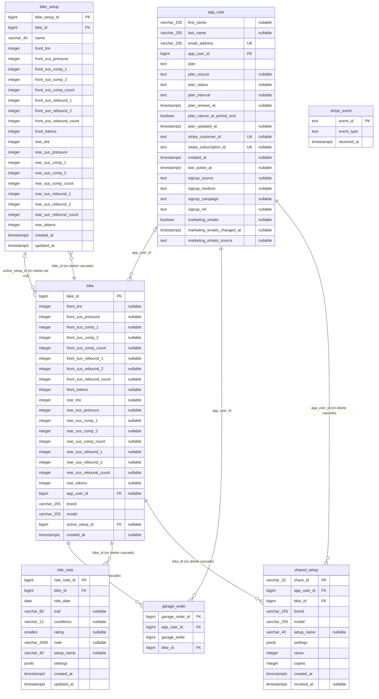

# Setups.Bike database

Postgres on Neon (`neondb`, us-west-2). The Lambdas connect through the pooled host; schema
work uses the direct host. The full schema is in [`db/schema.sql`](../db/schema.sql) and changes
go through numbered migrations in [`db/migrations/`](../db/migrations/).

## Roles

| Role | Used by | Can do |
| --- | --- | --- |
| `setupsbike_app` | All 13 Lambdas (`NEON_USERNAME`) | Read and write rows in the app tables and use their id sequences. Can't create, alter or drop anything, or change grants. Created by migration 006. |
| `neondb_owner` | Grant only, for migrations and maintenance scripts | Everything. Its password isn't stored in any Lambda. |

New tables made by a migration (run as `neondb_owner`) get the app role's grants automatically
through `ALTER DEFAULT PRIVILEGES`. Both passwords are generated by Neon's **Reset password**
(Neon rejects `\password`; to give a role its first password use `ALTER ROLE ... WITH PASSWORD`,
then reset it in the console). After resetting `setupsbike_app`, update `NEON_PASSWORD` on every
Lambda.

**Keeping this page current:** after applying a migration, re-dump the schema and regenerate the
diagram:

```powershell
& "C:\Program Files\PostgreSQL\18\bin\pg_dump.exe" -h ep-shiny-mountain-bfjvu2jn.c-5.us-west-2.aws.neon.tech -U neondb_owner -d neondb --schema-only --no-owner --no-acl -f db\schema.sql
npm run db:diagram
```

Then update the table notes below if the meaning of anything changed.

## Diagram

<!-- GENERATED:START (npm run db:diagram) -->
_Generated from `db/schema.sql`. 7 tables, 8 foreign keys._



**Triggers**
- `insert_garage_order_after_add_bike`: after insert on `bike`, runs `insert_garage_order()`

**Extra indexes** (besides primary keys and unique constraints)
- `bike_setup_name_per_bike` on `bike_setup` (bike_id, lower(btrim((name)::text))), unique
- `ride_note_by_bike` on `ride_note` (bike_id, ride_date DESC, ride_note_id DESC)
- `shared_setup_by_owner` on `shared_setup` (app_user_id, created_at DESC)
<!-- GENERATED:END -->

## Tables

| Table | What it holds | Written by |
|---|---|---|
| `app_user` | One row per Google account: name, email, and the plan (`free`/`pro`), its source (`stripe`, `comp`, later `apple`/`google`), status, renewal date and Stripe ids. `created_at` (sign-up) and `last_active_at` (garage last opened, stamped by getBikes at most hourly) feed the weekly numbers; accounts from before 2026-11-20 have no `created_at`. `marketing_emails` (true/false, NULL = never asked) with `_changed_at` and `_source` (existing_user, prompt, settings, resend, bounce, complaint) is the news-and-offers email list; existing accounts started on (migration 009), the e2e account off. | AddUser (sign-in), getBikes (`last_active_at`), stripeWebhook (plan), emailPrefs and resendWebhook (`marketing_emails`), `db/maintenance/comp_user.sql` |
| `bike` | A bike in a garage and its **current** settings: tire pressures, fork/shock pressure, compression and rebound (count = how many adjusters: 0 none, 1 single, 2 dual), volume tokens. `active_setup_id` is the saved setup last applied or saved. `created_at` is when it was added (none for bikes from before 2026-11-20). | addBike, updateBike, DeleteBike, bikeSetups (apply), rideNotes (reuse), sharedSetups (copy) |
| `garage_order` | The bike's position in its owner's garage. A trigger adds a row for every new bike; deleting a bike removes it. | trigger, reorderGarage, DeleteBike |
| `bike_setup` | Pro: named saved setups ("Bike park", "Wet") with a full copy of the 18 settings. Names are unique per bike, ignoring case. Max 20 per bike. | bikeSetups |
| `ride_note` | Pro: how a ride went (date, trail, conditions, 1–5 rating, note) plus a snapshot of the bike's settings at the time, in `settings` (jsonb). Max 500 per bike. | rideNotes |
| `shared_setup` | Pro: a public, read-only snapshot of a bike's settings behind an unguessable `share_id` (`setups.bike/?s=<id>`). Never holds the owner's name or email. `revoked_at` hides it for good. | sharedSetups |
| `stripe_event` | Ids of Stripe webhook events already handled, so a retried event isn't processed twice. | stripeWebhook |

## Reports

- `db/maintenance/weekly_numbers.sql`: read-only weekly report (sign-ups, active users, bikes,
  setups, ride notes, share links, plans). Leaves the e2e test account (user 6) out of activity
  counts; `-v days=30` changes the window, `-v exclude=6,1` leaves out more accounts.
  It ends with **capacity** numbers: database size as a share of Neon's free-plan 0.5 GB, active
  users in the last 24 h and 7 days, and the largest tables (the Scaling 2 triggers).
- Live health (requests, latency, errors, concurrency) is on the CloudWatch dashboard
  **SetupsBike** (us-west-1), with five `setupsbike-*` alarms that email Grant through the
  `setupsbike-alerts` SNS topic.

## Rules worth knowing

- **Deleting a bike** removes its garage position, saved setups, ride notes and share links
  (`ON DELETE CASCADE`).
- **Deleting a saved setup** clears `bike.active_setup_id` (`ON DELETE SET NULL`).
- **Pro limits are enforced in the Lambdas**, not the database: free plan 3 bikes, 20 setups per
  bike, 500 ride notes per bike, 100 active share links per user.
- **Snapshots never change:** `ride_note.settings` and `shared_setup.settings` keep the values from
  when they were made, even if the bike changes later.
- **Comped accounts** (`plan_source = 'comp'`) are never changed by Stripe webhooks.
